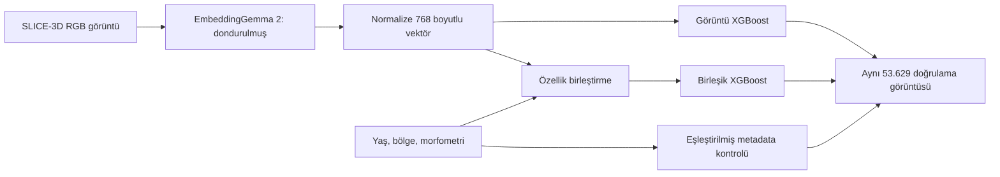

# EmbeddingGemma 2 görüntü deneyi

23 Ekim 2026. Bu aşama gerçek SLICE-3D görüntülerinden dondurulmuş bir encoder ile özellik çıkarır ve bu özelliklerde XGBoost eğitir. Model bir tokenizer olarak kullanılmaz; görüntü ön işleme, vision encoder, omurga ve pooling/projection sonucunda her görüntü için 768 boyutlu bir vektör elde edilir. Gemma ağırlıkları bu deneyde güncellenmez.



## Sabit model ve ön işleme

- Model: [google/embeddinggemma-2](https://huggingface.co/google/embeddinggemma-2).
- Revizyon: `914f7f89142e33e77833254d9c9b90c3cef7303b`.
- Ses modülü kapalı, etkin parametre sayısı 438.760.448.
- Apple MPS: bfloat16; CPU: float32. float16 kullanılmaz.
- Görüntüler PIL ile RGB okunur. Yeniden boyutlandırma modelin kendi processor'ına bırakılır.
- Pilot: `max_soft_tokens=70`, çıktı 768 boyut, L2 normalize float32 cache. Uygulanan token bütçesi yüklemede ayrıca doğrulanır.
- Metin prompt'u eklenmez; model kartında görüntü için prefix istenmez.
- Test görüntüleri çıkarıma dahil edilmez. Encoder eğitilmediğinden train ve validation aynı encoder ile işlenir.

70 token, 768 vektör boyutuyla aynı şey değildir. Token bütçesi görüntünün model içindeki çözünürlük/hesaplama bütçesini etkiler; vektör boyutu son çıktıdır. 70 token seçimi ince lezyon ayrıntısını kaybettirebilir. 280 token'a karşı sınıflandırma kalitesinin aynı kaldığı henüz gösterilmemiştir.

## Ölçülen hız

Aynı 256 eğitim görüntüsü, batch başına warm-up, GPU senkronizasyonu ve ayrı decode süresi kullanıldı. Bunlar tek tekrarın ölçümleridir; istatistiksel gecikme dağılımı değildir.

| Görüntü token bütçesi | Batch | 256 görüntü süresi | Görüntü/s |
| --- | ---: | ---: | ---: |
| 280 | 8 | 35,25 s | 7,26 |
| 280 | 16 | 38,74 s | 6,61 |
| 280 | 32 | 40,09 s | 6,39 |
| 280 | 64 | 49,29 s | 5,19 |
| 70 | 8 | 8,10 s | 31,59 |
| 70 | 16 | 8,01 s | 31,95 |

Bu değerler decode/model yükleme süresini içermez. Tam eğitim+doğrulama 352.189 görüntü için salt çıkarım tahmini 280 token'da 13,47 saat, 70 token'da 3,06 saattir. İşlemci/platform ve paket sürümleri benchmark JSON'larında kayıtlıdır. Process RSS, Apple GPU'nun toplam birleşik bellek kullanımını ölçmez.

## İlk karşılaştırmanın tasarımı

İlk pilot eğitim: **271 pozitif + rastgele 10.000 negatif = 10.271 lezyon**. Negatifler yalnızca mevcut eğitim grubundan seed=42 ile örneklenir. Validation **53.629 lezyon, 57 pozitif, 156 hasta** olarak bütünüyle korunur. Böylece değerlendirme prevalansı değişmez. Toplam 63.900 görüntü encode edilir.

Dört sonucu birlikte okuyun:

1. `baseline-v1`: mevcut metadata+morfometri modeli, 298.560 eğitim lezyonu.
2. `metadata-pilot-v1`: pilotun aynı 10.271 eğitim lezyonunda metadata+morfometri kontrolü.
3. `image-eg2-70-pilot-v1`: aynı pilotta yalnızca 768 görüntü özelliği.
4. `fusion-eg2-70-pilot-v1`: aynı pilotta görüntü vektörü + metadata/morfometri.

Embedding katkısını değerlendirmek için 2–4 arasındaki karşılaştırma daha doğrudandır. 1 ile 3/4 arasındaki fark eğitim örneklemesinden de etkilenebilir. Bütün başlıklarda temel XGBoost hiperparametreleri aynıdır; erken durdurma doğrulamada ayrı seçilir. Pilotun sınıf ağırlığı kendi eğitim prevalansından hesaplanır. Sınıf örnekleme ve ağırlıklandırma nedeniyle skorlar kalibre klinik risk olasılığı değildir.

AP ana karşılaştırma metriğidir; ROC-AUC, TPR≥0,8 bölgesinin normalize edilmemiş pAUC'si, Brier ve yüksek duyarlılıkta yanlış pozitif sayısı da raporlanır. Test bölümü son model seçilene kadar kullanılmaz. Aynı validation üzerinde erken durdurma/model seçimi yapıldığından sonuçlar bağımsız test performansı sayılmaz.

## Tekrar çalıştırma

Önce README'deki download/prepare adımlarını tamamlayın. Tüm komutlar repo kökünden çalışır. `--extra embeddings` seçeneklerini koruyun; aksi halde uv sonraki komutta opsiyonel bağımlılıkları ortamdan kaldırabilir.

```bash
uv sync --python 3.12 --extra embeddings --group dev --locked
uv run --extra embeddings python -m derm_context.embeddings benchmark \
  --config configs/embeddinggemma2-70.json \
  --output reports/my-70-benchmark.json
uv run --extra embeddings python -m derm_context.embeddings extract \
  --config configs/embeddinggemma2-70.json --batch-size 16 \
  --embedding-dir data/embeddings/embeddinggemma2-70-pilot \
  --max-train-negatives 10000
uv run --extra embeddings python -m derm_context.train_embeddings \
  --mode metadata --run-name metadata-pilot-v1 \
  --cache-dir data/embeddings/embeddinggemma2-70-pilot
uv run --extra embeddings python -m derm_context.train_embeddings \
  --mode image --run-name image-eg2-70-pilot-v1 \
  --cache-dir data/embeddings/embeddinggemma2-70-pilot
uv run --extra embeddings python -m derm_context.train_embeddings \
  --mode fusion --run-name fusion-eg2-70-pilot-v1 \
  --cache-dir data/embeddings/embeddinggemma2-70-pilot
uv run --extra embeddings python -m derm_context.compare \
  baseline-v1 metadata-pilot-v1 image-eg2-70-pilot-v1 fusion-eg2-70-pilot-v1
```

Cache 512 görüntüde bir checkpoint yazar. Kesilirse aynı extract komutunu yeniden çalıştırın; tamamlanmış bölümden devam eder. Model/cohort/config veya sürüm/device/dtype değişmişse devam etmeyi reddeder. Nihai vektörler ve kimlik dosyası SHA-256 ile doğrulanır. Kaynak veri/split hash'leri eğitim öncesi kontrol edilir; tüm validation grubunun mevcut olması zorunludur. Ham veri, hasta kimlikleri, embedding cache ve model ağırlıkları Git'e eklenmez.

Tam eğitim için `--max-train-negatives` seçeneğini kaldırıp **yeni bir embedding-dir** kullanın. Pilot cache'in üzerine farklı cohort yazılmaz. Aynı benchmark/run adıyla var olan raporun/modelin üzerine yazılmaz; yeni ad verin.

## macOS süreç ayrımı

Bu makinede XGBoost'u önce import eden süreçte PyTorch görüntü çıkarımı native segfault verdi; aynı görüntü ve model, XGBoost import edilmemiş temiz CPU ve MPS süreçlerinde çalıştı. Ortak veri okuma kodu eğitim modülünden ayrıldı; encoder CLI XGBoost'u yüklemez. Ayrı CLI komutlarıyla çıkarım/eğitim bu nedenle önemlidir. Notebook'ta XGBoost yüklediyseniz encoder için kernel'i yeniden başlatın veya ayrı CLI süreci kullanın. Kesin native kütüphane nedeni belirlenmiş değildir. Regresyon testi encoder girişinin XGBoost import etmediğini denetler.

## Lisans ve sonraki adım

Repo kodu [MIT](../LICENSE), Google modeli Apache-2.0, deney verisi CC-BY-NC-4.0 koşullarındadır. Kodun açık kaynak olması veri lisansını değiştirmez. Model ve veri indirme kaynakları ayrı tutulur.

Bu pilot, hasta bağlamı attention modelini veya tanısal metin erişimini henüz uygulamaz. Sonraki adımlar: tam eğitim cohort'u, 70/280 token kalite karşılaştırması, hasta bazlı belirsizlik aralıkları, kalibrasyon için ayrı ayrım, hastanın diğer lezyonlarından etiket kullanmadan bağlam ve bağımsız merkez testi.
